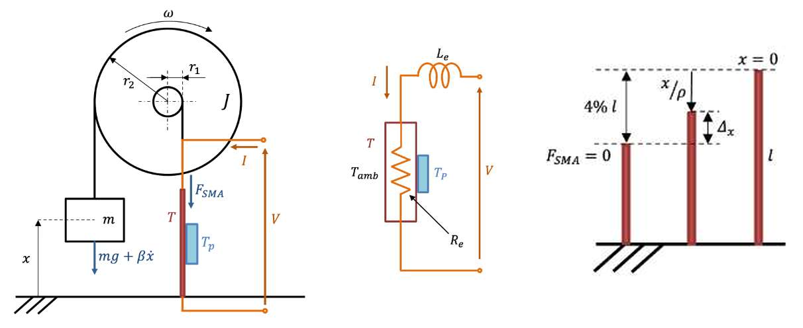
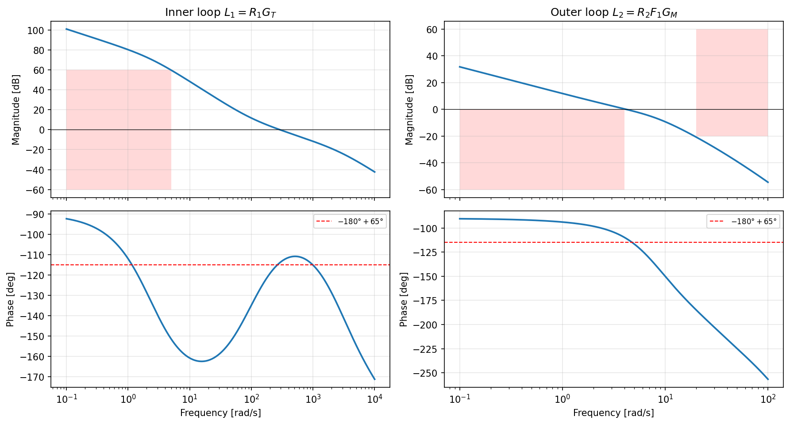
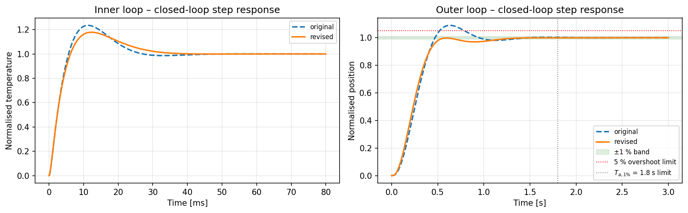
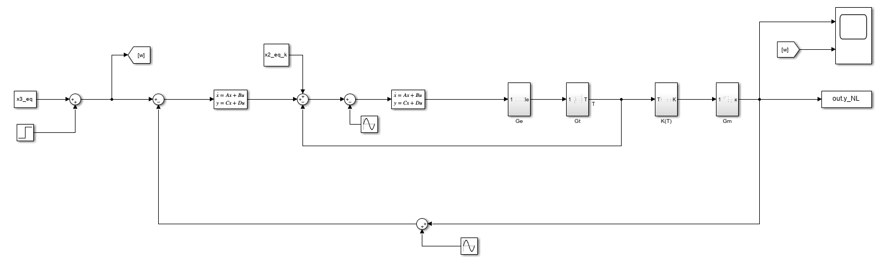
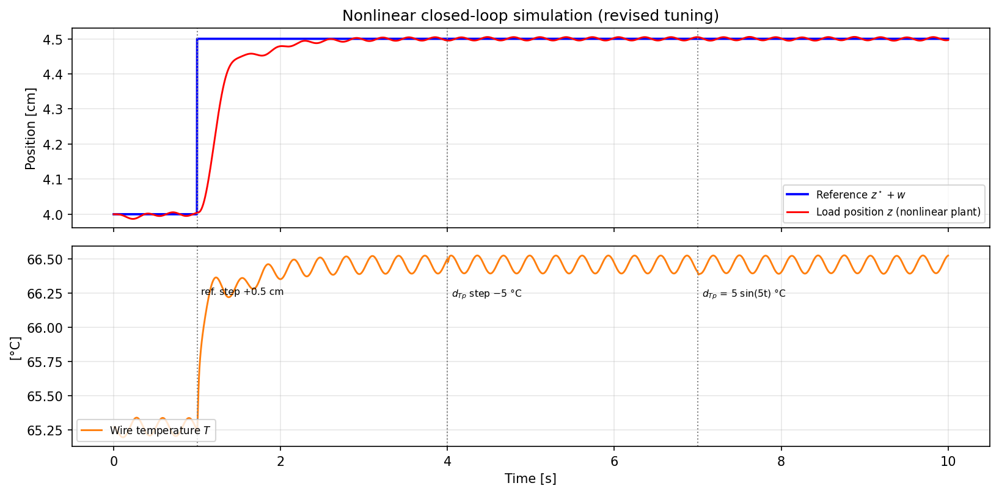

# Cascade Position Control of a Shape Memory Alloy Actuator

Group project for the course **Controlli Automatici T-2** (Automatic Control), B.Sc. in Automation Engineering, **University of Bologna**, A.Y. 2023/2024.
Developed by **Michael Quattrini, Federico Rinieri, Nicola Gaiotto and Almen Selimi**.

A load hangs from a pulley and is lifted by a **Shape Memory Alloy (SMA) wire**. When the wire is heated by an electric current it stiffens and contracts. The goal is to choose the **input voltage** that brings the load to a desired height and holds it there, despite temperature disturbances from a Peltier cell and noise on the position sensor.

The plant is nonlinear, with a quadratic Joule heating term and a sigmoidal temperature-dependent stiffness. Its dynamics span two very different time scales (electro-thermal vs mechanical), so the solution uses a **cascade architecture** designed by frequency-domain loop shaping:

- **inner loop:** voltage → wire temperature, PID, crossover about 290 rad/s;
- **outer loop:** temperature reference → load position, PI, crossover about 4 rad/s.



---

## Model

State $x = [I,\ T,\ z,\ \dot z]$ (current, wire temperature, load position, velocity), input $V$:

$$
\begin{aligned}
L_e \dot I &= -R_e I + V \\
C_{th} \dot T &= R_e I^2 - hS\,(T - T_{amb}) - \frac{T - T_p}{R_{th}} \\
\Big(m + \frac{J}{r_2^2}\Big)\ddot z &= -mg - \beta \dot z + \frac{r_1}{r_2} K(T)\Big(\delta l_{max} - \frac{r_1}{r_2} z\Big)
\end{aligned}
\qquad
K(T) = K_{max}\left(1 - \frac{1}{1 + e^{\,c\,(T - T_{avg})/T_{diff}}}\right)
$$

The model is linearised around $z^\star = 4$ cm. The equilibrium follows analytically from the force balance ($K^\star$), then the stiffness law ($T^\star$), then the thermal balance ($I^\star$):

| $I^\star$ | $T^\star$ | $z^\star$ | $V^\star$ |
|---|---|---|---|
| 0.795 A | 65.3 °C | 4.0 cm | 3.82 V |

$$
G_T(s) = \frac{5530}{s^2 + 89.68\,s + 210.4}, \qquad
G_M(s) = \frac{0.3257}{s^2 + 13.19\,s + 64.67}
$$

$G_T$ has real poles at −2.4 and −87.3 rad/s. $G_M$ is lightly damped, with poles at −6.6 ± 4.6j rad/s.

## Specifications

| Requirement | Target |
|---|---|
| Steady-state error | zero, for a 0.5 cm reference step and a ±5 °C Peltier step |
| Phase margin | > 65° |
| Peltier disturbance $d_{T_p}$ (5 °C, ω < 5 rad/s) | attenuated > 800× (58 dB) |
| Position-sensor noise (0.05 cm, ω > 20 rad/s) | attenuated > 10× (20 dB) |
| Step response | overshoot < 5 %, 1 % settling time < 1.8 s |

## Controller design

Both controllers are tuned with the classic analytic method: the zero(s) are placed to provide the phase lead needed for the target margin at the chosen crossover, and the gain sets the crossover. The integrator gives zero steady-state error, and extra high-frequency poles keep the controllers proper and filter noise.

- **Inner PID:** $R_1(s) = \mu_1 \dfrac{(1+\tau_z s)^2}{s\,(1+\tau_p s)(1+1.2\cdot10^{-5}s)}$. The crossover is placed near 290 rad/s so that $|L_1| > 58$ dB below 5 rad/s, which rejects the Peltier disturbance directly in the thermal loop.
- **Outer PI:** $R_2(s) = \mu_2 \dfrac{1+\tau s}{s\,(1+0.024s)(1+10^{-4}s)}$. It is designed on $G_M$ with the fast inner loop treated as ideal. Its crossover of about 4 rad/s comes from the settling-time requirement ($\omega_c \approx 460/(T_a M_f)$), and it keeps $|L_2| < -20$ dB above 20 rad/s to reject sensor noise.



The red regions in the magnitude plots are the forbidden zones derived from the specifications. In the phase plots, the dashed line marks the 65° margin requirement.

### Design review (2026)

When the project was published, the design was re-checked independently in Python (`tools/verify_design.py`). In the exam version, both controllers were tuned for exactly 65° of margin at crossover. However, the extra high-frequency poles, added afterwards, cost a few degrees of phase that the tuning did not account for. As a result, the true margins were about 59°, and the outer step response overshot by about 9 %. Raising the design targets to 72° (inner) and 75° (outer) compensates for this. Everything else is unchanged: same structure, same crossovers.

| | Exam tuning | Revised tuning | Spec |
|---|---|---|---|
| Inner loop: crossover / phase margin | 289 rad/s / 59.0° | 289 rad/s / **66.0°** | > 65° |
| Inner loop: $\lvert L_1(j5)\rvert$ | 62.7 dB | **59.7 dB** | > 58 dB |
| Outer loop: crossover / phase margin | 4.15 rad/s / 59.4° | 4.14 rad/s / **69.4°** | > 65° |
| Outer loop: $\lvert L_2(j20)\rvert$ | −23.1 dB | **−20.8 dB** | < −20 dB |
| Overshoot | 9.0 % | **≈ 0 %** | < 5 % |
| 1 % settling time | 1.31 s | **1.20 s** | < 1.8 s |



## Nonlinear validation

The controllers are validated on the **full nonlinear plant**. The Simulink model (`matlab/sma_nonlinear_closed_loop.slx`) contains the electrical, thermal, SMA-stiffness and mechanical subsystems, the two controllers and the disturbance sources.



The same closed loop was also re-simulated in Python. The test applies a +0.5 cm reference step at t = 1 s, a −5 °C Peltier step at t = 4 s and a 5 °C sinusoidal Peltier disturbance at 5 rad/s from t = 7 s. Sensor noise of 0.05 cm at 20 rad/s is present throughout.



The load reaches 4.5 cm with no overshoot. The inner thermal loop rejects the Peltier disturbances, which have no visible effect on the position. The small residual ripple, below 0.07 mm, is the attenuated sensor noise.

---

## Repository structure

```
├── matlab/
│   ├── sma_cascade_control.m          Equilibrium, linearisation, controller design, plots
│   └── sma_nonlinear_closed_loop.slx  Nonlinear closed-loop Simulink model (R2023b)
├── tools/
│   └── verify_design.py               Independent Python check + nonlinear simulation
└── figures/
```

## How to run

**MATLAB / Simulink** (R2023b or newer, Control System Toolbox):

```matlab
cd matlab
sma_cascade_control                  % designs the controllers and defines A1..D2
open_system('sma_nonlinear_closed_loop'); sim('sma_nonlinear_closed_loop');
```

The script must be run first, because the Simulink model reads its parameters and controller matrices from the workspace. To reproduce the exam tuning, set `Mf1 = 65` and `Mf = 65`.

**Python check:**

```
pip install numpy scipy matplotlib
python tools/verify_design.py
```

## Authors

- Michael Quattrini
- Federico Rinieri
- Nicola Gaiotto
- Almen Selimi

University of Bologna, Controlli Automatici T-2, A.Y. 2023/2024.
